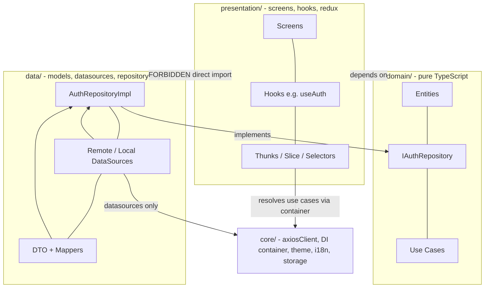
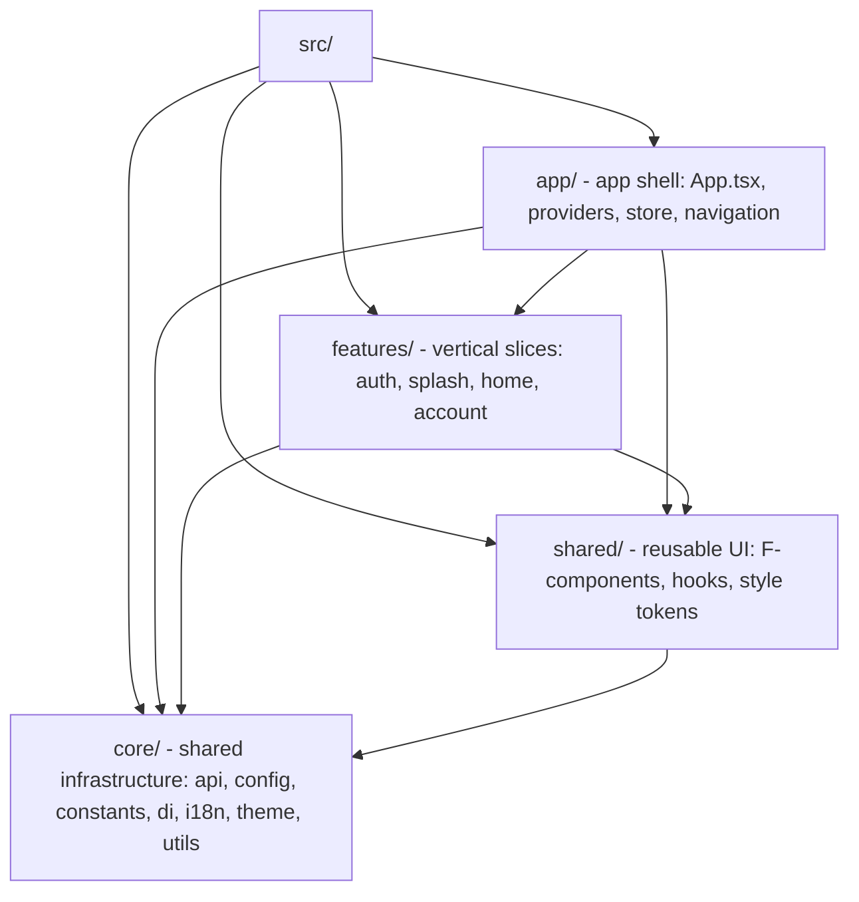
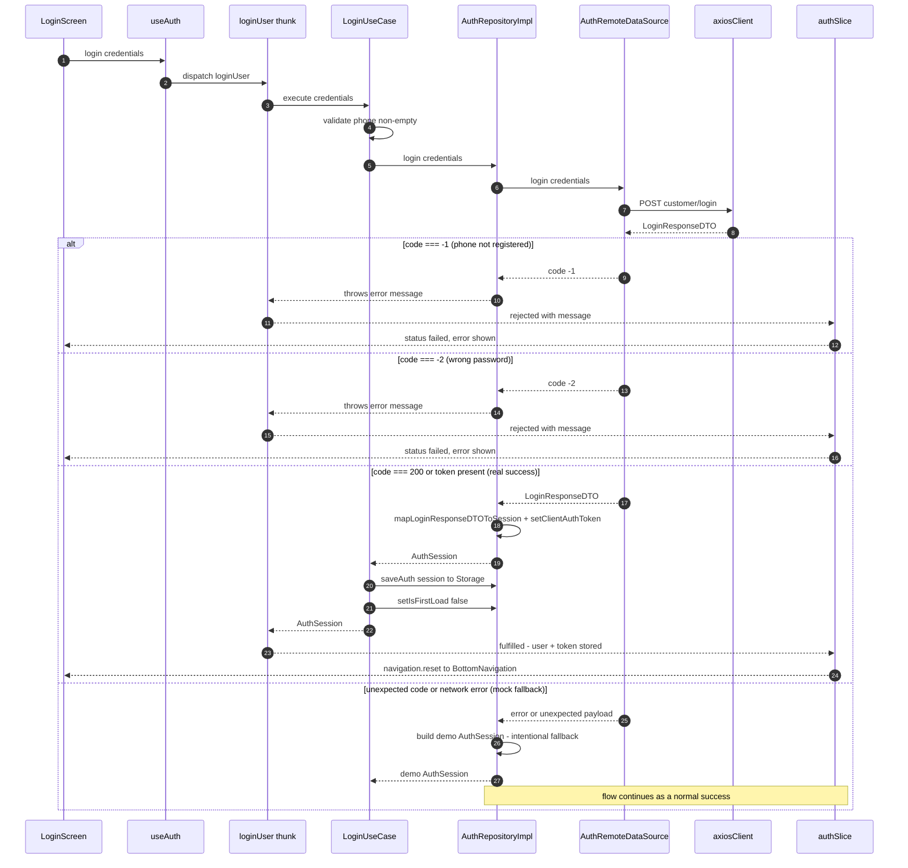
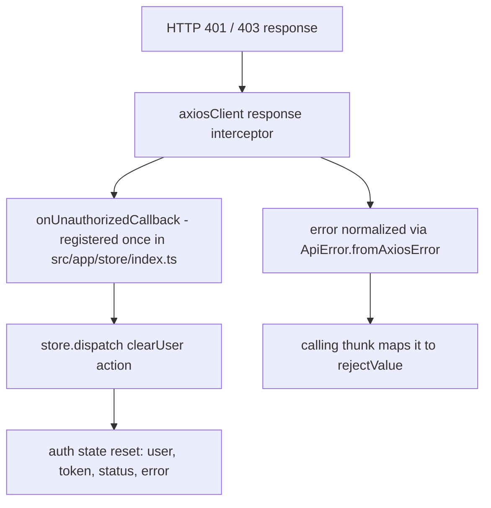
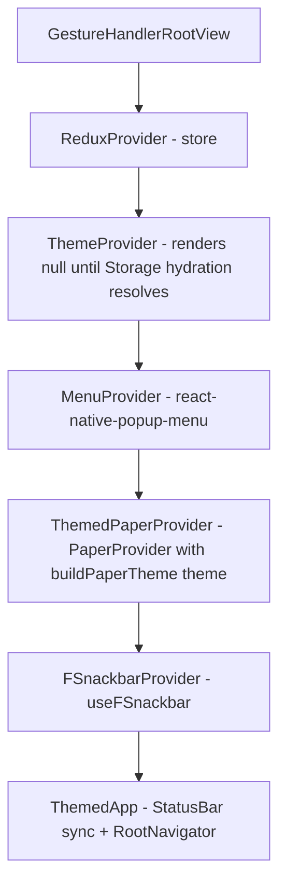

# ARCHITECTURE.md — System Architecture Reference

`ARCHITECTURE.md` is the system architecture reference for the ReactCore project. It
explains **how the system is designed, how it behaves at runtime, and why** — the layer
that `README.md` (setup, how-to, conventions) and the agent rules doc (`CLAUDE.md`,
exposed to every agent through the `AGENTS.md` symlink) intentionally do not cover.
For the visual design system — color tokens, typography, elevation, components — see
`DESIGN.md`, the project style guide.

| Document          | Answers                                                                           | Audience                                              |
| ----------------- | --------------------------------------------------------------------------------- | ----------------------------------------------------- |
| `README.md`       | How do I run, build, and follow conventions?                                      | Engineers onboarding                                  |
| `CLAUDE.md`       | What rules must AI coding agents follow?                                          | AI coding agents (via `AGENTS.md`)                    |
| `DESIGN.md`       | What do the UI look like — which colors, type styles, and components do I use?    | Engineers & agents building UI                        |
| `ARCHITECTURE.md` | How is the system designed, how does it behave at runtime, and why these choices? | Engineers & agents needing architecture understanding |

Where a rule already exists in `CLAUDE.md`, this document links to it and focuses on
rationale, behavior, and flows instead of restating the rule. Everything here is factual
and verifiable in the current codebase; intentional quirks are labeled as intentional.

---

## 1. Overview

ReactCore is a React Native **template/demo application** built with Clean Architecture
plus Vertical Feature Slicing. It ships one complete end-to-end feature (`auth` —
phone-number + OTP login) and three presentation-only features
(`splash`, `home`, `account`). It is designed to be cloned and extended: the `auth`
feature demonstrates every layer; the others demonstrate the minimal footprint.

**Tech stack**

| Concern        | Choice                                                         |
| -------------- | -------------------------------------------------------------- |
| Runtime        | `react-native` 0.87.1, `react` 19.2.3, TypeScript `^6.0.3`     |
| State          | Redux Toolkit (thunks only — no RTK Query / React Query)       |
| Networking     | `axios` behind a single `axiosClient` singleton                |
| Navigation     | React Navigation 7 (`native-stack` + `bottom-tabs`)            |
| UI kit         | `react-native-paper` 5 + in-house `F*` components (`src/shared`) |
| i18n           | `i18next` + `react-i18next`, locked to `lng: 'vi'`             |
| Persistence    | `AsyncStorage` wrapped by `src/core/utils/storage.ts`          |
| Notifications  | Firebase Messaging + `@notifee/react-native`                   |
| 3D viewer      | `react-native-webview` (purifier 3D model)                     |

**Design principles**

1. **Dependencies point inward.** `presentation → domain ← data`; the domain layer is
   pure TypeScript and knows nothing about React Native, Redux, or axios.
2. **Vertical feature slicing.** Each feature owns its domain, data, and presentation
   code under `src/features/<name>/`; cross-feature wiring happens only in `src/app/`
   and `src/core/di/container.ts`.
3. **One way to do things.** One HTTP client, one storage wrapper, one DI container,
   one state pattern (slice + thunk + selectors + hook). No parallel mechanisms.
4. **Explicit over magic.** No codegen, no decorators, no service locators beyond the
   plain object exported from `container.ts`. Wiring is readable in one file.

---

## 2. Architecture Model

### 2.1 The three layers

Each feature is split into `domain/`, `data/`, and `presentation/`:

| Layer           | Contains                                        | May import                                | Must not import                              |
| --------------- | ----------------------------------------------- | ----------------------------------------- | -------------------------------------------- |
| `domain/`       | entities, repository interfaces, use cases      | pure TS, other domain files               | `data/*`, `presentation/*`, axios, RN, redux |
| `data/`         | DTOs + mappers, data sources, `*RepositoryImpl` | `domain/`, `axiosClient`, `Storage`       | `presentation/*`, redux, RN UI               |
| `presentation/` | screens, hooks, thunks, slices, selectors       | `domain/`, `core/di`, redux, react-native | `data/*` (go through domain + DI)            |

The dependency rule that gives the architecture its shape: **`presentation` and `data`
both depend on `domain`, never on each other.** The repository interface
(`IAuthRepository`) lives in domain; the implementation (`AuthRepositoryImpl`) lives in
data; the binding between them happens only in the DI container.



### 2.2 Vertical feature slicing

Layers are **not** top-level directories. `src/features/auth/` contains its own
`domain/`, `data/`, and `presentation/`; nothing outside the feature may reach into its
data layer. The feature's public surface is its barrel `index.ts`, which exports
**domain + presentation only** — the data layer is wired invisibly through the DI
container, so consumers can never grow a dependency on implementation details.

Presentation-only features (`splash`, `home`, `account`) have no `domain/` or `data/`
directories at all — they are screens plus (optionally) Redux plumbing. This is a
deliberate YAGNI decision: layers without behavior would only be noise.

---

## 3. System Components

### 3.1 `src/` topology



- **`app/`** — composition root: mounts providers, the Redux store, and the navigators.
- **`core/`** — infrastructure shared by every feature; knows nothing about features
  except the DI container, which is the single point that imports data-layer classes.
- **`shared/`** — presentation building blocks (`FText`, `FFilledButton`, `FDialog`, ...)
  and style tokens (`FIconStyles`, `FElevation`, `FInputSize`). No business logic.
- **`features/`** — one folder per business capability, three layers inside.

### 3.2 API layer (`src/core/api/`)

- **`axiosClient.ts`** — a single `axios` instance configured from
  `src/core/config/env.ts` (`baseURL`, 30 s timeout). It owns two module-level values:
  `authToken` and `onUnauthorizedCallback`, exposed through `setClientAuthToken` and
  `setOnUnauthorizedCallback`. **Interceptors never read Redux** — this is what breaks
  the circular `store ↔ api` import that plagues typical RN setups; the token is pushed
  in explicitly by `AuthRepositoryImpl`.
  - Request interceptor: attaches `Authorization: Bearer <token>` when a token is set;
    logs the full request behind `__DEV__`.
  - Response interceptor: on HTTP **401/403** fires `onUnauthorizedCallback` (registered
    exactly once, in `src/app/store/index.ts`); then normalizes **every** error through
    `ApiError.fromAxiosError` before rejecting.
- **`apiError.ts`** — `ApiError` carries `statusCode`, business `code`, and `details`.
  Mapping rules: server responded → message from body (`data.message` / `data.error`),
  408 gets a dedicated timeout message; no response → `NETWORK_ERROR` message; setup
  failure → `UNKNOWN_ERROR`. All user-facing messages are Vietnamese.
- **`endpoints.ts`** — the `ENDPOINTS` const is the only place URLs are written
  (`ENDPOINTS.AUTH.LOGIN = 'customer/login'`; dynamic endpoints are functions, e.g.
  `SETUP_CALL(guid)`).

**Only `*RemoteDataSource` files may import `axiosClient`.** Everything else reaches the
network through a data source.

### 3.3 DI container (`src/core/di/container.ts`)

A hand-rolled, module-level singleton — deliberately not a DI framework:

```ts
const authRepository = new AuthRepositoryImpl(
  authRemoteDataSource,
  authLocalDataSource,
);
export const container = {
  loginUseCase: new LoginUseCase(authRepository),
  logoutUseCase: new LogoutUseCase(authRepository),
  checkBiometricsUseCase: new CheckBiometricsUseCase(authRepository),
};
```

Everything is **eagerly instantiated at import time**; the graph is small enough that
lazy resolution would buy nothing. The container is the only file allowed to import the
data layer across features, which makes it the de-facto composition root for the
backend half of the app (the UI half is composed in `src/app/providers`). In tests it
is trivially bypassed — use-case tests inject hand-built `jest.Mocked<IAuthRepository>`
objects instead of touching the container at all.

### 3.4 Theme (`src/core/theme/`)

- `FTheme.ts` (light) and `DarkTheme.ts` are full React Navigation `DefaultTheme`
  objects extended with an app-specific `ColorsProps` token set (`primary*`,
  `secondary*`, status groups, `title/label/body/subtitle/placeHolder`, greys...).
- `ThemeContext.tsx` provides `useTheme() → {theme, isDark, mode, setMode}`. Modes are
  `'light' | 'dark' | 'system'`; `system` resolves against `useColorScheme()` via
  `resolveTheme` / `resolveIsDark` in `themeUtils.ts`.
- The selected mode persists under `Storage.KEY_THEME_MODE`. `ThemeProvider` renders
  `null` until that AsyncStorage read resolves (`isReady` flag) — consumers never see a
  flash of the wrong theme, but tests must await hydration.
- `paperTheme.ts` rebuilds a Paper MD3 theme from the navigation theme
  (`buildPaperTheme`), so Paper components and `F*` components always agree on colors.

### 3.5 i18n (`src/core/i18n/`)

`i18n.ts` initializes i18next with `lng: 'vi'`, `fallbackLng: 'en'`, and **no language
detector** — a current product decision, not an oversight. Locale resources are
`locales/en.json` and `locales/vi.json`. Initialization is a side-effect import
(`import '@/core/i18n'`) performed first thing in `src/app/App.tsx`, guaranteeing it
runs before any `useTranslation` call in the tree.

### 3.6 Storage (`src/core/utils/storage.ts`)

`Storage` is the single wrapper over AsyncStorage. It JSON-encodes every value on write
and parses on read, spreads `STORAGE_KEYS` (`src/core/constants/storageKeys.ts`) so keys
are reachable as `Storage.AUTH_TOKEN`, `Storage.KEY_THEME_MODE`, etc. The JSON round
trip is why callers must **never** pre-`JSON.stringify` (it would double-encode).

### 3.7 Firebase / FCM (`src/core/utils/firebase/fcmHelper.ts`)

FCM auto-initialization is **off**; registration is manual and explicit:
`getFcmToken()` requests notification permission, registers the device, and fetches the
token; `registerListenerWithFCM()` wires foreground message handling (displaying local
notifications through notifee) and returns an unsubscribe function. Both are invoked
from a single `useEffect` in `src/app/App.tsx`, giving the app a controlled token
lifecycle instead of fire-on-launch behavior.

---

## 4. Runtime Data Flow — the `auth` Case Study

`auth` is the only full three-layer feature, so it serves as the end-to-end reference
for how a user action becomes state.

### 4.1 Login sequence

Call chain: `LoginScreen` → `useAuth().login` → `loginUser` thunk →
`container.loginUseCase` → `AuthRepositoryImpl` → `AuthRemoteDataSource` (axiosClient) →
`mapLoginResponseDTOToSession` → `authSlice` extraReducers → UI re-render.



Three things in this flow are contract-sensitive:

1. **The mock-login fallback is intentional** (template/demo behavior — do not "fix"
   it). Any response that is neither `code 200`/token-bearing nor `code -1`/`-2` — and
   any network error — produces a demo session (`demo-token-<timestamp>`) and the login
   succeeds. The two real error branches are the exceptions, rethrown by exact message.
2. **The error-message strings are an API contract.** `AuthRepositoryImpl` throws the
   literal Vietnamese messages, and `LoginScreen` branches on
   `error?.includes('Số điện thoại chưa được đăng ký')` /
   `error?.includes('Mật khẩu không đúng')` to switch its inline field errors. Change
   one side without the other and the UI silently degrades.
3. **Persistence happens in the use case, not the repository's `login`.**
   `LoginUseCase.execute` orchestrates `login` → `saveAuth` (token + user to `Storage`)
   → `setIsFirstLoad(false)`, then `setClientAuthToken` has already primed the axios
   interceptor for all subsequent requests.

### 4.2 401/403 handling

Session invalidation is handled at the HTTP layer, not per-screen:



`setOnUnauthorizedCallback` is wired **exactly once**, in `src/app/store/index.ts`,
immediately after `configureStore` — the callback dispatches `clearUser()`. Screens do
nothing special: any request that comes back 401/403 resets auth state, and the UI
reacts through the normal selector subscriptions. The error itself still propagates to
the originating thunk as an `ApiError`, so callers can also surface a message.

### 4.3 Phone + OTP auth flow

`PhoneLoginScreen` dispatches the `requestOtp`/`verifyOtp` thunks → container use
cases → `AuthRepositoryImpl`, whose remote data source falls back to a mock
demo-user when the real endpoint is unavailable. The earlier password/biometrics
path was removed; `useBiometrics`, `LoginUseCase`, and the `react-native-touch-id`
dependency no longer exist.

---

## 5. State Management Design

**All async server state flows through one pattern** — four files per slice, always in
the same order:

| File            | Responsibility                                                                     |
| --------------- | ---------------------------------------------------------------------------------- |
| `*Thunks.ts`    | `createAsyncThunk` calling a use case via `container`; typed `rejectValue: string` |
| `*Slice.ts`     | `createSlice`: sync reducers + `extraReducers` for thunk lifecycle                 |
| `*Selectors.ts` | `createSelector` wrappers — memoized, never raw `state.x` reads in components      |
| `use<X>.ts`     | the only component-facing API: wraps `useAppDispatch`/`useAppSelector` + `unwrap`  |

Components never dispatch thunks or read state directly; they call `useAuth()`. The
thunk's `.unwrap()` turns the action into a throw-on-reject promise that resolves with
the typed payload — and on rejection throws the `rejectValue` **string** directly, so
screens `try/catch` around a login call and inspect the message itself (`error.includes(...)`),
which is exactly how the Vietnamese error substrings reach `LoginScreen`.

**Store wiring** (`src/app/store/`): `rootReducer.ts` combines feature reducers
(currently only `auth`); `index.ts` configures the store with
`serializableCheck: false` (moment objects and other non-serializable payloads are
tolerated by design) and registers the 401 callback (§4.2). Typed hooks
`useAppDispatch` / `useAppSelector` are exported from the same file — plain
`useDispatch`/`useSelector` lose the typing and are not used.

**Why theme is not in Redux:** theme changes must re-render every themed component but
should not invalidate selector memoization or trip the redux devtools for what is pure
view config. Theme therefore lives in React Context (`ThemeProvider`), sits **above**
the Paper provider (which rebuilds its MD3 theme from it), and persists itself — Redux
never hears about it.

---

## 6. Navigation & App Shell

### 6.1 Provider tree

Provider order in `src/app/providers/AppProviders.tsx` is **significant** — each layer
depends on the ones above it:



Gesture handlers need a root before anything renders; Redux comes before anything that
dispatches; Theme before anything that reads colors; Menu before popups; Paper before
Paper-based components; Snackbar before any screen that might toast. `ThemedApp`
(`src/app/App.tsx`) keeps the OS status bar and `Appearance.setColorScheme` in sync
with the resolved theme. `App.tsx` also owns the single FCM effect (§3.7) wrapping all
of this.

### 6.2 Navigators

- `RootNavigator.tsx` — `native-stack`, `initialRouteName="Splash"`, themed by
  `useTheme().theme`. Routes: `Splash`, `BottomNavigation`, `Onboarding`, `Login`,
  `Home`, `Account` (typed in `types.ts` as `RootStackParamList`). Convention:
  `headerShown: false`; `Onboarding`, `Home`, and `Account` animate `fade`, `Login`
  animates `slide_from_bottom`, and `Splash` / `BottomNavigation` leave the platform
  default.
- `BottomNavigator.tsx` — two tabs, `Home` and `Account`, safe-area-aware height,
  `FIcon` + `FText` tab items.
- Navigation is type-safe via `useAppNavigation()` from
  `src/app/navigation/types.ts`; route params are declared centrally in
  `RootStackParamList` / `BottomTabParamList`.

### 6.3 Splash gating

`SplashScreen` is the launch gate: a 2-second timer shows the logo, then it reads
`Storage.KEY_FIRST_LOAD` — `null` / `true` routes to `replace('Onboarding')`, `false`
routes to `replace('Login')` (the error path also falls back to `Login`). The replace
(not push) prevents going "back" into splash.

The onboarding gate lives in `src/features/onboarding` (presentation-only):
`OnboardingScreen` writes the flag to `false` (Skip, or Next on the last slide) before
replacing to `Login`, and `LoginUseCase` also writes it to `false` after every
successful login. `LoginScreen` reads it into local state only to hide the Appbar
back button on a genuine first load.

---

## 7. Key Design Decisions

| Decision                                                        | Rationale                                                                               | Consequence / trade-off                                                                                                  |
| --------------------------------------------------------------- | --------------------------------------------------------------------------------------- | ------------------------------------------------------------------------------------------------------------------------ |
| React Query / RTK Query banned; plain RTK thunks                | dependency removed 2026-09-07; caching layer was overkill for this app's request volume | all async state flows through explicit thunks; more boilerplate, zero cache-invalidation complexity                      |
| Theme lives in React Context, not Redux                         | re-render isolation for theme-only changes; keeps redux state purely domain-shaped      | mode persistence handled by `ThemeProvider` via `Storage.KEY_THEME_MODE`; theme not visible in devtools                  |
| Hand-rolled DI container (module-level singleton, eager)        | zero extra dependencies; the whole object graph is visible in one file                  | trivially mockable in tests (inject mocks into use cases, ignore the container); no lazy init or scoping                 |
| Mock-login fallback in `AuthRepositoryImpl`                     | intentional demo/template behavior so the app runs without a backend                    | any unexpected response or network error logs in as a demo user; documented as intentional, never "fixed"                |
| Auth token in module variable; interceptors never read Redux    | avoids circular `store ↔ api` imports                                                   | token must be set explicitly via `setClientAuthToken` (done in `AuthRepositoryImpl`); easy to forget in new entry points |
| i18next locked to `lng: 'vi'`, `fallbackLng: 'en'`, no detector | current product decision; VN-market app                                                 | only `en.json` / `vi.json` exist; device language never auto-switches the app                                            |
| FCM auto-init off; manual registration in `fcmHelper`           | controlled token lifecycle (permission prompt + registration at an app-chosen moment)   | registration code runs in one `App` effect; no notifications until that effect runs                                      |
| `serializableCheck: false` in store middleware                  | non-serializable payloads (e.g. moment objects) are tolerated in actions/state          | dev warnings for non-serializable values suppressed; discipline shifts to code review                                    |

---

## 8. Testing Strategy

- **Runner**: Jest 29 with `preset: '@react-native/jest-preset'`. Quality gates are
  `npx tsc --noEmit`, `npm test`, `npm run lint` — all three must pass.
- **Global setup is minimal.** `jest.setup.js` only mocks the clipboard module;
  every other mock is declared inline with `jest.mock()` — a test file is
  self-contained and readable on its own. Tests that
  render the App tree must mock the native surface (notifee, firebase messaging,
  AsyncStorage, gesture-handler, paper, safe-area); the canonical mock block
  lives in `__tests__/App.test.tsx`.
- **Assertions use `react-test-renderer` 19** (`renderer.create` + `renderer.act`).
  Because `ThemeProvider` renders `null` until AsyncStorage hydration resolves, any
  test rendering themed trees must wrap effects in `renderer.act()` and await.
- **Use-case tests** bypass the DI container: they construct the use case with
  hand-built `jest.Mocked<IAuthRepository>` objects. This is the payoff of the
  constructor-injection container design (§3.3).
- **Colocation**: feature tests sit next to their source (`AuthDTO.test.ts`,
  `LoginUseCase.test.ts`, `authSlice.test.ts`); app-level tests live in `__tests__/`.
  New use cases, DTO mappers, and slices require unit tests.
- **ESM-only RN libraries** need to be added to the single `transformIgnorePatterns`
  whitelist group in `jest.config.js` (currently: `immer`, `@reduxjs/toolkit`,
  `react-redux`, `@react-navigation`, `@react-native-async-storage`, plus the
  react-native defaults) — never a second entry.

---

## 9. Extension Model

The design is validated every time a feature is added; a new feature is a mechanical
mapping onto the structures above (concrete step-by-step instructions live in
`README.md` §6 and the agent rules doc — this section explains the _why_ of the shape):

1. **Domain first** (`entities → repository interface → use cases`): pure TS, so it is
   written and unit-tested with zero RN knowledge. This is where business rules live —
   if a rule matters, it is here, not in a screen or a data source.
2. **Data second** (`DTO + mapper → RemoteDataSource → RepositoryImpl`): the data source
   is the only file that sees axios; the mapper absorbs API shape drift so the domain
   entity never changes when the backend reshapes a field.
3. **Wire in `container.ts`**: instantiate data sources, wrap them in the repository
   impl, expose the use cases. This is the only line of code that knows both halves.
4. **Presentation** (`thunk → slice → selectors → hook`): the reducer is registered in
   `src/app/store/rootReducer.ts`; components consume only the hook.
5. **Screen + route**: register the route in `types.ts` and the navigator; export the
   public surface through the feature `index.ts` (domain + presentation only).

Presentation-only features skip steps 1–3 entirely (see `splash`). The cost of a new
feature is proportional to its behavior — never to the architecture.
