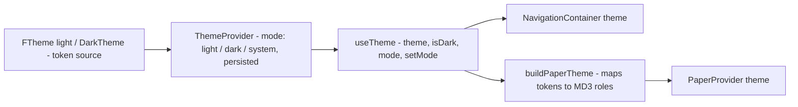

# DESIGN.md — Project Style Guide

`DESIGN.md` is the **visual design reference** for the ReactCore project: the color,
typography, elevation, sizing, spacing, radius, and icon tokens that make up the app
theme, and the rules for using them. It is synced with the code — every value here is
quoted from `src/core/theme/FTheme.ts` (light) and `src/core/theme/DarkTheme.ts` (dark).

For system architecture, data flows, and design decisions, see `ARCHITECTURE.md`.
For setup and conventions, see `README.md` / `CLAUDE.md` (via the `AGENTS.md` symlink).

## 1. Theme Pipeline

The theme is a React Navigation `DefaultTheme` extended with an app-specific token
set (`ColorsProps` for colors, a custom `fonts` scale). It is **not** in Redux — it
lives in React Context (`ThemeProvider`, `src/core/theme/ThemeContext.tsx`) and feeds
both the navigators and the Material 3 theme used by `react-native-paper`:

Rules that follow from this pipeline:

- **Always** read colors through `useTheme()` from `@/core/theme`. Never statically
  import `FTheme` for colors in UI code — dark mode depends on it.
- Screens use the `createStyles(colors)` factory pattern (`StyleSheet.create` at file
  bottom, memoized on `colors`).
- Only tokens from `ColorsProps` are valid color values — no raw hex in components.
- The selected mode persists under `Storage.KEY_THEME_MODE`; `ThemeProvider` renders
  `null` until hydration resolves.

## 2. KGR Color System

The color system is derived 1:1 from the KGR style guide and defined in
`src/core/theme/colors.ts`, feeding into `src/core/theme/FTheme.ts` (light) and
`src/core/theme/DarkTheme.ts` (dark).

### 2.1 Background Tokens

| Token          | Design Name      | Value     | Description                              |
| -------------- | ---------------- | --------- | ---------------------------------------- |
| `bgDarkOver`   | BG Dark — Over   | `#121F37` | Elevated surfaces / cards in dark mode   |
| `bgDarkBase`   | BG Dark — Base   | `#000C21` | Base screen background in dark mode      |
| `bgDarkUnder`  | BG Dark — Under  | `#000000` | Deepest background / sunken surfaces     |
| `bgLightOver`  | BG Light — Over  | `#FFFFFF` | Cards and surfaces in light mode         |
| `bgLightBase`  | BG Light — Base  | `#FAFBFC` | Base screen background in light mode     |
| `bgLightUnder` | BG Light — Under | `#F4F4F4` | Sunken / subtle background in light mode |

### 2.2 Content trên nền tối (onDark)

Content colors on dark surfaces using white `#FFFFFF` with varying opacity:

| Token             | Design Name    | Value                       | Use                                       |
| ----------------- | -------------- | --------------------------- | ----------------------------------------- |
| `onDarkPrimary`   | 100 — Primary  | `rgba(255, 255, 255, 1)`    | Primary text, titles, high-emphasis icons |
| `onDarkSecondary` | 70 — Secondary | `rgba(255, 255, 255, 0.7)`  | Body text, medium-emphasis labels         |
| `onDarkTertiary`  | 50 — Tertiary  | `rgba(255, 255, 255, 0.5)`  | Subtitles, secondary captions             |
| `onDarkDisabled`  | 30             | `rgba(255, 255, 255, 0.3)`  | Placeholder text, disabled controls       |
| `onDarkStroke`    | 15 — Stroke    | `rgba(255, 255, 255, 0.15)` | Borders, dividers, subtle outlines        |

### 2.3 Content trên nền sáng (onLight)

Content colors on light surfaces using `#1F242F` (`grey900`) with varying opacity:

| Token              | Design Name    | Value                    | Use                                       |
| ------------------ | -------------- | ------------------------ | ----------------------------------------- |
| `onLightPrimary`   | 100 — Primary  | `rgba(31, 36, 47, 1)`    | Primary text, titles, high-emphasis icons |
| `onLightSecondary` | 70 — Secondary | `rgba(31, 36, 47, 0.7)`  | Body text, medium-emphasis labels         |
| `onLightTertiary`  | 50 — Tertiary  | `rgba(31, 36, 47, 0.5)`  | Subtitles, secondary captions             |
| `onLightDisabled`  | 30             | `rgba(31, 36, 47, 0.3)`  | Placeholder text, disabled controls       |
| `onLightStroke`    | 15 — Stroke    | `rgba(31, 36, 47, 0.15)` | Borders, dividers, subtle outlines        |

### 2.4 Functional Colors

#### Success

| Token                | Value     | Role                        |
| -------------------- | --------- | --------------------------- |
| `successDim`         | `#ECF8ED` | Background container        |
| `successDimHover`    | `#C5EAC6` | Background hover            |
| `successDimPress`    | `#A9DFAA` | Background pressed / active |
| `successStrong`      | `#44BA46` | Icon / text / solid button  |
| `successStrongHover` | `#3EA940` | Hover state                 |
| `successStrongPress` | `#3EA940` | Press state                 |

#### Warning

| Token                | Value     | Role                        |
| -------------------- | --------- | --------------------------- |
| `warningDim`         | `#FFF5E6` | Background container        |
| `warningDimHover`    | `#FEF0D9` | Background hover            |
| `warningDimPress`    | `#FDE1B0` | Background pressed / active |
| `warningNormal`      | `#FA9E00` | Icon / text / solid button  |
| `warningNormalHover` | `#E18E00` | Hover state                 |
| `warningNormalPress` | `#C87E00` | Press state                 |

#### Danger (Error)

| Token                | Value     | Role                        |
| -------------------- | --------- | --------------------------- |
| `dangerLight`        | `#FDE8E9` | Background container        |
| `dangerLightHover`   | `#FCDDDE` | Background hover            |
| `dangerLightActive`  | `#F9B9BB` | Background pressed / active |
| `dangerNormal`       | `#ED1C24` | Icon / text / solid button  |
| `dangerNormalHover`  | `#D51920` | Hover state                 |
| `dangerNormalActive` | `#BE161D` | Active / press state        |

#### Information

| Token             | Value     | Role                        |
| ----------------- | --------- | --------------------------- |
| `infoDim`         | `#EDF4FE` | Background container        |
| `infoDimHover`    | `#E4EEFE` | Background hover            |
| `infoDimActive`   | `#C8DCFD` | Background active / pressed |
| `infoNormal`      | `#4D8FF9` | Icon / text / solid button  |
| `infoNormalHover` | `#4581E0` | Hover state                 |
| `infoNormalPress` | `#3E72C7` | Press state                 |

### 2.5 Color Ramps (Scales 50–900)

| Scale          | Green (Primary Brand) | Orange (Accent 1) | Grey (Neutrals) | Blue (Accent 2) |
| -------------- | --------------------- | ----------------- | --------------- | --------------- |
| **50**         | `#ECF8ED`             | `#FEF0E9`         | `#F9FAFB`       | `#EBF9FF`       |
| **100**        | `#C5EAC6`             | `#FBD0BB`         | `#F2F4F7`       | `#C1EDFF`       |
| **200**        | `#A9DFAA`             | `#F9B99A`         | `#E7ECF4`       | `#A3E4FF`       |
| **300**        | `#82D183`             | `#F6986C`         | `#D8DEE8`       | `#7AD7FF`       |
| **400**        | `#69C86B`             | `#F4854F`         | `#B9C3D5`       | `#60D0FF`       |
| **500 (Base)** | `#44BA46`             | `#F16623`         | `#A2ADC4`       | `#38C4FF`       |
| **600**        | `#3EA940`             | `#DB5D20`         | `#8394AD`       | `#33B2E8`       |
| **700**        | `#008242`             | `#AB4819`         | `#566580`       | `#288BB5`       |
| **800**        | `#005C2F`             | `#853813`         | `#3E485C`       | `#1F6C8C`       |
| **900**        | `#00371C`             | `#652B0F`         | `#1F242F`       | `#18526B`       |

### 2.6 Theme Token Mappings (`FTheme` & `DarkTheme`)

These semantic tokens are accessed via `useTheme().theme.colors`:

#### Brand & Secondaries

| Token                  | Light                            | Dark                          |
| ---------------------- | -------------------------------- | ----------------------------- |
| `primary`              | `#44BA46` (`green500`)           | `#44BA46` (`green500`)        |
| `primarySub`           | `#3EA940` (`green600`)           | `#69C86B` (`green400`)        |
| `primaryBackground`    | `#ECF8ED` (`green50`)            | `rgba(68, 186, 70, 0.16)`     |
| `primaryBorder`        | `#A9DFAA` (`green200`)           | `rgba(68, 186, 70, 0.45)`     |
| `secondary1`           | `#F16623` (`orange500`)          | `#F16623` (`orange500`)       |
| `secondarySub1`        | `#DB5D20` (`orange600`)          | `#F6986C` (`orange300`)       |
| `secondaryBackground1` | `#FEF0E9` (`orange50`)           | `rgba(241, 102, 35, 0.16)`    |
| `secondaryBorder1`     | `#F9B99A` (`orange200`)          | `rgba(241, 102, 35, 0.45)`    |
| `secondary2`           | `#38C4FF` (`blue500`)            | `#38C4FF` (`blue500`)         |
| `secondarySub2`        | `#33B2E8` (`blue600`)            | `#7AD7FF` (`blue300`)         |
| `secondaryBackground2` | `#EBF9FF` (`blue50`)             | `rgba(56, 196, 255, 0.16)`    |
| `secondaryBorder2`     | `#A3E4FF` (`blue200`)            | `rgba(56, 196, 255, 0.45)`    |
| `secondary3`           | `#FA9E00` (`warningNormal`)      | `#FA9E00` (`warningNormal`)   |
| `secondarySub3`        | `#E18E00` (`warningNormalHover`) | `#FDE1B0` (`warningDimPress`) |
| `secondaryBackground3` | `#FFF5E6` (`warningDim`)         | `rgba(250, 158, 0, 0.16)`     |
| `secondaryBorder3`     | `#FDE1B0` (`warningDimPress`)    | `rgba(250, 158, 0, 0.45)`     |
| `secondary4`           | `#4D8FF9` (`infoNormal`)         | `#4D8FF9` (`infoNormal`)      |
| `secondarySub4`        | `#4581E0` (`infoNormalHover`)    | `#C8DCFD` (`infoDimActive`)   |
| `secondaryBackground4` | `#EDF4FE` (`infoDim`)            | `rgba(77, 143, 249, 0.16)`    |
| `secondaryBorder4`     | `#C8DCFD` (`infoDimActive`)      | `rgba(77, 143, 249, 0.45)`    |

#### Status Groups

| Token               | Light     | Dark                       |
| ------------------- | --------- | -------------------------- |
| `info`              | `#4D8FF9` | `#4D8FF9`                  |
| `infoSub`           | `#4581E0` | `#C8DCFD`                  |
| `infoBackground`    | `#EDF4FE` | `rgba(77, 143, 249, 0.16)` |
| `infoBorder`        | `#E4EEFE` | `rgba(77, 143, 249, 0.45)` |
| `success`           | `#44BA46` | `#44BA46`                  |
| `successSub`        | `#3EA940` | `#69C86B`                  |
| `successBackground` | `#ECF8ED` | `rgba(68, 186, 70, 0.16)`  |
| `successBorder`     | `#C5EAC6` | `rgba(68, 186, 70, 0.45)`  |
| `warning`           | `#FA9E00` | `#FA9E00`                  |
| `warningSub`        | `#E18E00` | `#FDE1B0`                  |
| `warningBackground` | `#FFF5E6` | `rgba(250, 158, 0, 0.16)`  |
| `warningBorder`     | `#FEF0D9` | `rgba(250, 158, 0, 0.45)`  |
| `error`             | `#ED1C24` | `#ED1C24`                  |
| `errorSub`          | `#D51920` | `#F9B9BB`                  |
| `errorBackground`   | `#FDE8E9` | `rgba(237, 28, 36, 0.16)`  |
| `errorBorder`       | `#FCDDDE` | `rgba(237, 28, 36, 0.45)`  |

#### Navigation Surfaces & Neutrals

| Token          | Light                      | Dark                        | Description                             |
| -------------- | -------------------------- | --------------------------- | --------------------------------------- |
| `background`   | `#FAFBFC` (`bgLightBase`)  | `#000C21` (`bgDarkBase`)    | Main screen background                  |
| `card`         | `#FFFFFF` (`bgLightOver`)  | `#121F37` (`bgDarkOver`)    | Card & sheet surface                    |
| `text`         | `#1F242F` (`grey900`)      | `#FFFFFF` (`onDarkPrimary`) | Primary text                            |
| `border`       | `#D8DEE8` (`grey300`)      | `rgba(255, 255, 255, 0.15)` | Primary border                          |
| `notification` | `#ED1C24` (`dangerNormal`) | `#ED1C24` (`dangerNormal`)  | Badges & notifications                  |
| `white`        | `#FFFFFF`                  | `#000C21`                   | Semantic surface (inverts in dark mode) |
| `grey1`        | `#F2F4F7` (`grey100`)      | `#121F37` (`bgDarkOver`)    | Secondary surface                       |
| `grey2`        | `#E7ECF4` (`grey200`)      | `rgba(255, 255, 255, 0.15)` | Tertiary surface / border               |
| `disable`      | `#A2ADC4` (`grey500`)      | `rgba(255, 255, 255, 0.3)`  | Disabled elements                       |
| `black`        | `#1F242F` (`grey900`)      | `#FFFFFF`                   | Semantic text/black role                |

#### Text Ramp & Borders

| Token         | Light                                        | Dark                                           |
| ------------- | -------------------------------------------- | ---------------------------------------------- |
| `title`       | `#1F242F` (`onLightPrimary`)                 | `#FFFFFF` (`onDarkPrimary`)                    |
| `label`       | `rgba(31, 36, 47, 0.9)`                      | `rgba(255, 255, 255, 0.9)`                     |
| `body`        | `rgba(31, 36, 47, 0.7)` (`onLightSecondary`) | `rgba(255, 255, 255, 0.7)` (`onDarkSecondary`) |
| `subtitle`    | `rgba(31, 36, 47, 0.5)` (`onLightTertiary`)  | `rgba(255, 255, 255, 0.5)` (`onDarkTertiary`)  |
| `placeHolder` | `rgba(31, 36, 47, 0.3)` (`onLightDisabled`)  | `rgba(255, 255, 255, 0.3)` (`onDarkDisabled`)  |
| `border1`     | `rgba(31, 36, 47, 0.15)` (`onLightStroke`)   | `rgba(255, 255, 255, 0.08)`                    |
| `border2`     | `#D8DEE8` (`grey300`)                        | `rgba(255, 255, 255, 0.15)` (`onDarkStroke`)   |

### 2.7 Mapping to Material 3 (react-native-paper)

`buildPaperTheme` (`src/core/theme/paperTheme.ts`) maps tokens to Material 3 roles:

| MD3 role           | Token source         | Light Value             | Dark Value                  |
| ------------------ | -------------------- | ----------------------- | --------------------------- |
| `primary`          | `colors.primary`     | `#44BA46`               | `#44BA46`                   |
| `background`       | `colors.background`  | `#FAFBFC`               | `#000C21`                   |
| `surface`          | `colors.card`        | `#FFFFFF`               | `#121F37`                   |
| `onSurface`        | `colors.label`       | `rgba(31, 36, 47, 0.9)` | `rgba(255, 255, 255, 0.9)`  |
| `outline`          | `colors.border2`     | `#D8DEE8`               | `rgba(255, 255, 255, 0.15)` |
| `onSurfaceVariant` | `colors.placeHolder` | `rgba(31, 36, 47, 0.3)` | `rgba(255, 255, 255, 0.3)`  |

### 2.8 Usage Guidelines

1. **Semantic Tokens First**: Always prefer semantic tokens (`colors.primary`, `colors.title`, `colors.background`, `colors.success`, etc.) via `useTheme()`. This guarantees instant, automatic dark-mode compliance.
2. **Direct Scale Tokens**: Ramps like `colors.green500`, `colors.grey900`, or raw `colors.raw.functional.danger.normal` are available directly on `theme.colors` when building specialized UI primitives.
3. **No Raw Hex Values**: Avoid hardcoding hex codes in screens and components.

## 3. Typography

The full scale lives in `FTheme.fonts` — **47 keys**: 18 canonical styleguide
tokens (exported standalone as `TypographyStyles`), 25 legacy aliases, and 4
navigation styles. Everything uses the bundled **Clan Pro** family with
`letterSpacing: 0` (values: `fontSize / lineHeight`; family from the ramp name):

**Canonical ramp** (new code uses these):

| Token            | Size / Line                       | Family         | Use                     |
| ---------------- | --------------------------------- | -------------- | ----------------------- |
| `headline0-3`    | 128, 96, 72, 60 (line = size)     | ClanPro-Bold   | display sizes           |
| `headline4`      | 48 / 60                           | ClanPro-Bold   | large display           |
| `headline5`      | 36 / 40                           | ClanPro-Bold   | hero titles             |
| `headline6`      | 30 / 36                           | ClanPro-Bold   | page titles             |
| `headline7`      | 26 / 32                           | ClanPro-Bold   | section titles          |
| `headline8`      | 22 / 28                           | ClanPro-Bold   | subsection titles       |
| `bodyLabel01-04` | 18/28, 16/24, 14/20, 12/12        | ClanPro-Medium | emphasized body, labels |
| `body01-05`      | 18/28, 16/24, 14/20, 12/18, 10/12 | ClanPro-Book   | body, captions          |

**Legacy aliases** (deprecated; each maps 1:1 to a canonical token — migrate
call sites as files are touched):

| Alias                                              | Maps to       | Resolves to  |
| -------------------------------------------------- | ------------- | ------------ |
| `largeTitle`                                       | `headline5`   | 36/40 Bold   |
| `title1`                                           | `headline7`   | 26/32 Bold   |
| `title2`                                           | `headline8`   | 22/28 Bold   |
| `title3`, `buttonText1`                            | `bodyLabel01` | 18/28 Medium |
| `title4`, `buttonText2`, `label1`                  | `bodyLabel02` | 16/24 Medium |
| `title5`, `buttonText3`, `label3`                  | `bodyLabel03` | 14/20 Medium |
| `title6`, `buttonText4`                            | `bodyLabel04` | 12/12 Medium |
| `bodyText1`                                        | `body01`      | 18/28 Book   |
| `bodyText2`, `subtitle1`, `label2`, `placeholder1` | `body02`      | 16/24 Book   |
| `subtitle2`, `label4`, `placeholder2`              | `body03`      | 14/20 Book   |
| `buttonText5`, `subtitle3`, `label5`               | `body04`      | 12/18 Book   |
| `subtitle4`                                        | `body05`      | 10/12 Book   |

**Navigation styles** (`regular`, `medium`, `bold`, `heavy`) exist for React
Navigation's `fonts` contract and require **explicit `fontFamily` + `fontWeight`**
(enforced by `NavigationFontStyleProps` types): `regular` = `body03` @ '400',
`medium` = `bodyLabel03` @ '500', `bold` = Bold 14/20 @ '700', `heavy` =
Bold 16/24 @ '700'.

Usage rules:

- Text renders through `<FText typo="...">` — prefer a canonical token from the
  ramp above; do not set `fontSize` by hand.
- Fonts are bundled: the Clan Pro family (`ClanPro-Book.ttf` / `ClanPro-Medium.ttf` /
  `ClanPro-Bold.ttf`) lives in `src/assets/fonts/` (source of truth), is copied to
  `android/app/src/main/assets/fonts/`, and on iOS is registered via Xcode resources +
  `UIAppFonts` in `ios/ReactCore/Info.plist`. Weight map: 400→`ClanPro-Book`,
  500→`ClanPro-Medium`, 700→`ClanPro-Bold`. Italic variants exist in the font set but
  are not bundled — do not add font files on your own.
- In dark theme every style keeps its metrics; only `color` changes (to `#F4F7FF`),
  via `DarkTheme`'s derived `darkFonts` map.

## 4. Elevation

`Felevation` (`src/shared/styles/FElevation.tsx`) provides 8 shadow tokens:
`{top,bottom,left,right} × {1,2}` — direction is where the shadow points, strength 2
is tighter/darker. iOS uses box shadows; Android uses `elevation` plus a white
background:

| Token                | iOS shadow                                                        | Android                                     |
| -------------------- | ----------------------------------------------------------------- | ------------------------------------------- |
| `*1` (any direction) | color`rgba(0, 0, 0, 0.03)`, offset 4px along direction, radius 20 | `elevation: 20`, `backgroundColor: 'white'` |
| `*2` (any direction) | color`rgba(0, 0, 0, 0.06)`, offset 4px along direction, radius 15 | `elevation: 15`, `backgroundColor: 'white'` |

Example: `Felevation.top1` = shadow cast upward (`shadowOffset: {width: 0, height: -4}`
on iOS) — intended for surfaces docked to the bottom edge (tab bars, sheets).
Note the hardcoded Android `backgroundColor: 'white'` — pair these tokens with an
explicit themed background when used on non-white surfaces (see Known Deviations).

## 5. Sizes, Spacing & Radius

Control dimensions live in `src/shared/styles/`:

| Token set    | Token    | Height | Radius | Padding |
| ------------ | -------- | ------ | ------ | ------- |
| `FInputSize` | `size48` | 48     | 999    | 16      |
| `FInputSize` | `size56` | 56     | 999    | 16      |

These are the only sanctioned control heights — do not invent 44/52/etc.
`FButton` (`src/shared/components/FButton.tsx`) hardcodes the sanctioned button
sizes in its `SIZE` map — `l` = 48 (padding 12), `m` = 40 (padding 8) — and
pairs text: `l` → `bodyLabel02` (16/24), `m` → `bodyLabel03` (14/20).

### 5.1 Space scale — screen/layout (`tokens.space`, 8px grid + 4px fine-tune)

`src/shared/styles/tokens.ts`, from Figma. Use for margins between sections and
screen-level padding:

| Token        | Value | Token        | Value |
| ------------ | ----- | ------------ | ----- |
| `space.xs`   | 4     | `space._4xl` | 56    |
| `space.sm`   | 8     | `space._5xl` | 64    |
| `space.md`   | 16    | `space._6xl` | 80    |
| `space.lg`   | 24    | `space._7xl` | 120   |
| `space.xl`   | 32    |              |       |
| `space._2xl` | 40    |              |       |
| `space._3xl` | 48    |              |       |

### 5.2 Component spacing (`tokens.spacing`, Figma `spacing/*`)

Padding/gap **inside** components (chân button, khoảng cách icon–text):

| Token          | Value | Figma         |
| -------------- | ----- | ------------- |
| `spacing._3xs` | 4     | `spacing/3XS` |
| `spacing._2xs` | 8     | `spacing/2XS` |
| `spacing.xs`   | 12    | `spacing/XS`  |
| `spacing.s`    | 16    | `spacing/S`   |

Ready-made StyleSheet helpers in `src/shared/styles/spacing.ts` — `p_/px_/py_/gap_`
× `3xs/2xs/xs/s` (e.g. `spacing.p_s`, `spacing.px_xs`, `spacing.gap_2xs`). Spread
them into style arrays: `style={[spacing.px_s, {backgroundColor: colors.white}]}`.

### 5.3 Border radius (`tokens.borderRadius`)

| Token                 | Value | Use (Figma)                               |
| --------------------- | ----- | ----------------------------------------- |
| `borderRadius.small`  | 8     | Button, small card                        |
| `borderRadius.medium` | 16    | Card nhỏ, banner                          |
| `borderRadius.big`    | 32    | Phân chia section, card lớn               |
| `borderRadius.full`   | 999   | Pill / circle (RN clamps to half the box) |

### 5.4 Usage rules

1. No raw numbers for `padding*`, `gap`, `margin*`, `borderRadius` in
   `src/features/**` and `src/shared/components/**`.
2. Screen/layout spacing → `tokens.space.*`; component-internal padding/gap ≤16 →
   `tokens.spacing.*` or `spacing` helpers; ≥24 inside a component →
   `tokens.space.*`. Only `spacing` has 12; only `space` has 24/32/40+. Values in
   between (17–23): snap to the nearest token, or add a new one to `tokens.ts`
   per rule 5.
3. Exemptions (literal value allowed): `0`; runtime-derived values
   (`insets.bottom`); geometry-coupled component insets (e.g. `FSwitch` thumb
   inset) — each with a short comment saying why. Position properties
   (`top/left/right/bottom`), view `width/height`, `borderWidth`, and icon `size`
   are not spacing and stay literal.
4. Pills/circles use `borderRadius.full` (RN clamps to half the box).
5. New tokens: edit `tokens.ts` first, update this file in the same commit.

## 6. Iconography

Icons are **not** an icon font. `src/shared/styles/FIconStyles.tsx` exports two
registries of static SVG XML strings:

- `FFilled` — filled variants (e.g. `FFilled.home`, `FFilled.user_profile`)
- `FOutlined` — outline variants

Rules:

- Every SVG path must contain a **literal `fill="black"`** — `FIcon` tints by string
  replacement; anything else silently renders un-tintable black.
- Render with `<FIcon icon={FFilled.home} size={24} iconColor={colors.primary} />`.
- `iconColor` must come from the theme (`useTheme()`), never a hex literal.

## 7. Component Inventory

All shared UI lives in `src/shared/components` and is imported from `@/shared/components`.
There is no other sanctioned source of UI primitives:

| Component               | Purpose                    | Tokens consumed                                        |
| ----------------------- | -------------------------- | ------------------------------------------------------ |
| `FText`                 | all text rendering         | `fonts.*` via `typo`, text-ramp colors                 |
| `FButton`               | all button variants        | spacing tokens, ramp/semantic colors, `bodyLabel02/03` |
| `FTextInput`            | form inputs                | `FInputSize`, `body02`, `placeHolder`, `border*`       |
| `FAppbar`               | screen headers             | `title`, surfaces, `Felevation`                        |
| `FIcon` / `FIconButton` | iconography                | `FFilled`/`FOutlined`, any color token                 |
| `FLoading`              | loading overlay            | `primary*`                                             |
| `FProgress`             | progress indication        | `primary*`                                             |
| `FSwitch`               | toggles                    | `primary*`, `disable`                                  |
| `FSlider`               | value sliders              | `primary*`                                             |
| `FStepIndicator`        | multi-step flows           | `primary*`, `grey*`                                    |
| `FExpansionPanel`       | accordions                 | `title/label`, `border*`                               |
| `FBottomSheet`          | bottom sheets              | surfaces,`Felevation`                                  |
| `FDialog`               | modal dialogs              | surfaces,`title/body`                                  |
| `FSnackbar`             | toasts (via`useFSnackbar`) | status groups                                          |
| `FTooltip`              | hover/press hints          | `grey*`, `title`                                       |

Screens compose these; shared styling helpers live in `src/shared/styles`
(`tokens`, `spacing`, `Felevation`, `FInputSize`, `FFilled`/`FOutlined`).

## 8. Known Deviations

Documented facts, not bugs to "fix" casually:

1. **Italic Clan Pro variants are not bundled** — only Book/Medium/Bold ship in the
   app (see Typography and `CLAUDE.md`).
2. **`Felevation` hardcodes Android `backgroundColor: 'white'`**
   (`src/shared/styles/FElevation.tsx`) — not dark-mode aware. When using elevation
   tokens in dark theme, set an explicit themed background after spreading the token.
