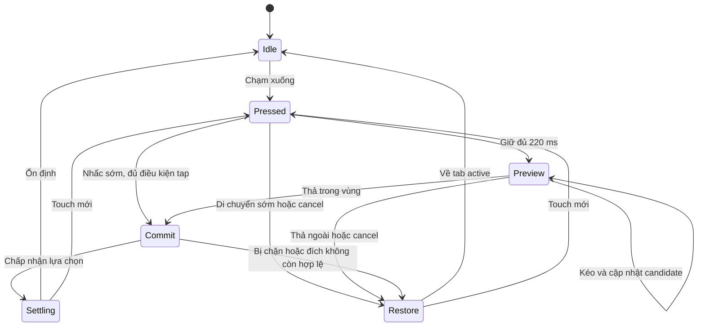

# Đặc tả Bottom Navigation 4 tabs — giao diện, tương tác và chuyển động

Ngày: 23/09/2026  
Dự án: KGR / React Native  
Trạng thái: Đề xuất triển khai để thiết kế, mobile và QA thống nhất hành vi.

## 1. Mục tiêu và phạm vi

Xây dựng thanh điều hướng dưới gồm đúng 4 tab, chuyển động mềm, phản hồi nhanh và lấy cảm hứng từ video `ScreenRecording_09-23-2026 09-23-20_1.mov`.

Đặc điểm quan sát từ video: thanh nền dạng capsule, icon bố trí ngang, một capsule sáng hơn trượt phía sau icon; chuyển động có cảm giác mềm và kéo giãn; đoạn cuối có nền xuyên thấu và icon active dạng filled.

Video không xác nhận đầy đủ cơ chế bấm giữ/kéo, cấu hình vật lý hoặc timing. Các hành vi kéo, thông số kích thước, màu sắc và thời gian trong tài liệu này là đề xuất sản phẩm, không phải thông số trích xuất chính xác từ video. Chưa phải bản implementation đã kiểm chứng trên thiết bị.

Phạm vi gồm: tap, giữ và kéo ngang, thả để chọn, hủy thao tác, animation highlight/icon, đồng bộ navigation, accessibility và tiêu chí nghiệm thu. Không bao gồm chuyển trang bằng swipe trên vùng nội dung.

## 2. Quyết định tương tác chính

1. Bốn vùng tab có kích thước và vị trí cố định.
2. Chỉ có một capsule highlight chạy phía sau icon.
3. Chạm nhanh: chuyển đến tab được chạm sau khi nhấc ngón tay.
4. Giữ khoảng 220 ms: vào chế độ chọn bằng kéo; capsule đi đến vị trí ngón tay.
5. Trong khi kéo: chỉ preview tab. Màn hình hiện tại vẫn giữ nguyên, không gọi API hoặc mount màn hình của các tab đi ngang qua.
6. Thả trong vùng hợp lệ: chọn tab preview và snap capsule vào tâm tab đó.
7. Thả ngoài vùng hợp lệ hoặc hệ thống hủy gesture: không đổi tab, capsule quay về tab đang active thực tế.
8. Không dùng quán tính để ném capsule sang tab khác. Vị trí thả quyết định lựa chọn.
9. Không khóa thanh tab trong lúc animation đang chạy.

Tên tab thực tế lấy từ cấu hình dự án. Ví dụ minh họa: Trang chủ, Thiết bị, Tự động hóa, Tài khoản; đây không phải xác nhận danh sách chức năng final.

## 3. Giao diện và layout

### 3.1. Cấu trúc hiển thị

Thứ tự từ dưới lên:

| Lớp | Nội dung | Quy tắc |
| --- | --- | --- |
| Nền | Màu nền, border mảnh; blur tùy chọn | Cố định trong suốt thao tác |
| Highlight | Một capsule active | Absolute, không nhận touch |
| Icon | Bốn icon tại tâm bốn ô | Không dịch ngang theo capsule |
| Tương tác | Bốn vùng tab và bộ xử lý gesture chung | Hit area cố định, không scale theo hình ảnh |

Thanh nằm nổi phía trên safe area dưới. Container ngoài có thể giữ shadow; container trong clip nền/blur theo bo góc. Không để clipping cắt shadow ngoài.

### 3.2. Kích thước đề xuất

| Thuộc tính | Giá trị khởi đầu |
| --- | --- |
| Số tab | 4 |
| Margin ngang | 16 dp mỗi bên, cộng safe area ngang nếu có |
| Chiều cao thanh | 64 dp, không gồm safe area |
| Padding trong | 6 dp |
| Border radius thanh | 32 dp |
| Chiều cao capsule | 52 dp |
| Chiều rộng capsule khi nghỉ | slotWidth − 4 dp |
| Icon | 24–26 dp |
| Khoảng cách đến safe area dưới | 8 dp |
| Vùng bấm | Toàn bộ ô tab; tối thiểu 48 × 48 dp |

Đo `barWidth` thực bằng `onLayout`. Công thức tính theo tọa độ local của thanh:

```text
slotWidth = (barWidth - 2 * padding) / 4
center(i) = padding + slotWidth * (i + 0.5), i = 0..3
pillWidth = slotWidth - 4
left(i) = center(i) - pillWidth / 2
```

Đo hitbox và vùng render cùng một hệ tọa độ; không trộn absoluteX trên màn hình với x local. Dùng tọa độ của container không bị transform để tránh vị trí touch bị lệch.

### 3.3. Màu sắc và icon

Để mô phỏng video: nền tối, icon sáng, highlight trắng khoảng 18–22% opacity. Khi áp dụng app thật, map vào token semantic của dự án: `tabBar.background`, `tabBar.indicator`, `tabBar.iconActive`, `tabBar.iconInactive`, `tabBar.border`. Không coi màu mô phỏng là màu final của KGR.

Icon inactive dạng outline, active dạng filled nếu bộ icon có cặp tương ứng. Cả hai dùng cùng viewBox, kích thước và tâm thị giác. Nếu không có cặp filled, chỉ đổi màu/opacity; không tự biến dạng path.

Bản giống video dùng icon-only. Mỗi tab vẫn có tên accessibility rõ ràng. Nếu thiết kế sau này thêm label luôn hiển thị, phải điều chỉnh chiều cao và hit area; không nhét label vào layout 64 dp mà chưa kiểm tra.

## 4. Flow A — chạm nhanh để chuyển tab

Ví dụ: tab 1 đang active, user chạm tab 3.

| Bước | Hành động / hệ thống | Giao diện và chuyển động |
| --- | --- | --- |
| 1 | Ngón tay chạm tab 3 | Icon tab 3 scale nhẹ xuống 0.94 trong khoảng 70 ms; chưa đổi màn hình |
| 2 | Nhấc tay trước ngưỡng giữ, di chuyển không quá 8 dp | Xác nhận tap, phát `tabPress` một lần |
| 3 | Sự kiện không bị chặn | Yêu cầu navigation sang tab 3 ngay; không chờ animation xong |
| 4 | Navigation xác nhận state mới | Capsule trượt từ vị trí hiện tại đến tab 3, giãn nhẹ theo hướng đi |
| 5 | Icon đổi trạng thái | Icon cũ fade filled về outline; icon mới crossfade sang filled |
| 6 | Kết thúc | Capsule thu về chiều rộng chuẩn, icon về scale 1 |

Khi capsule đi ngang tab 2, icon tab 2 không được active. Trạng thái icon của tap dựa vào tab được navigation chọn, không dựa vào vị trí capsule.

Tap lại tab đang active: vẫn phát `tabPress` để giữ các hành vi ứng dụng đã cấu hình như scroll-to-top; không điều hướng thêm hoặc chạy capsule một vòng. Không tự thêm scroll-to-top nếu màn hình chưa định nghĩa.

Tap bị `preventDefault`: reset phản hồi nhấn; capsule giữ hoặc quay về tab active thực tế. Không đổi icon thành selected giả.

## 5. Flow B — bấm giữ rồi kéo qua các tab

### 5.1. Bắt đầu giữ

- User có thể bắt đầu giữ trên bất kỳ ô tab nào.
- Chạm xuống: phản hồi nhấn giống tap.
- Giữ đủ 220 ms, chuyển động trước thời điểm đó không quá 8 dp: kích hoạt chế độ preview.
- Hủy animation highlight đang chạy; bắt đầu từ vị trí capsule đang hiển thị, không reset về tâm tab cũ.
- Capsule tiến nhanh đến vị trí x đã clamp của ngón tay trong khoảng 100–140 ms. Nếu user kéo ngay, hủy đoạn tiến này và bám trực tiếp theo ngón tay.
- Capsule tăng `scaleY` nhẹ lên khoảng 1.03 và sáng thêm tối đa 0.04 opacity tuyệt đối.
- Có thể rung nhẹ một lần khi kích hoạt nếu dự án đã có haptic. Haptic không phải điều kiện bắt buộc.
- Giữ trên tab khác chưa làm đổi màn hình. Tab đó chỉ là preview cho đến khi nhấc tay.

### 5.2. Di chuyển ngang

Capsule di chuyển liên tục theo ngón tay, không nhảy lần lượt qua tâm từng tab. Tâm capsule bị giới hạn từ tâm tab 1 đến tâm tab 4.

```text
dragCenterX = clamp(pointerLocalX, center(0), center(3))
rawCandidate = clamp(floor((pointerLocalX - padding) / slotWidth), 0, 3)
```

Trong drag, tâm cập nhật trực tiếp trên UI thread để theo kịp ngón tay. Chỉ phần giãn/thu được làm mềm; không gán một spring mới cho tâm ở mọi frame khiến capsule trễ tay.

| Tình huống | Phản hồi hình ảnh |
| --- | --- |
| Kéo chậm | Capsule đi sát ngón tay, gần chiều rộng chuẩn |
| Kéo nhanh | Capsule giãn ngang tối đa khoảng 12%; không kéo dài phủ nhiều tab |
| Dừng tay | Capsule giữ tâm, chiều rộng trở về chuẩn |
| Đảo chiều | Capsule đổi hướng ngay; độ giãn giảm rồi đổi hướng, không giật về tab cũ |
| Đi qua ranh giới tab | Icon preview mới tăng sáng/scale 1.04; preview cũ trở về bình thường |
| Kéo vượt đầu/cuối | Capsule dừng ở giới hạn, không vượt khỏi thanh hoặc vòng sang đầu kia |

Có hysteresis 6 dp quanh ranh giới để tránh preview nhấp nháy: chỉ đổi sang ô kế tiếp khi ngón tay vượt qua ranh giới thêm 6 dp; tương tự khi quay lại. Nếu nhảy qua nhiều ô trong một event, tính thẳng ô tại vị trí mới. Thả đúng vùng hysteresis thì giữ candidate hiện tại.

Trong drag, icon preview dùng outline sáng và scale nhẹ; icon active thực tế vẫn giữ filled. Chỉ tab active thực tế có `accessibilityState.selected=true`. Khi commit mới crossfade icon đích sang filled. Cách này phân biệt màn hình đang mở với lựa chọn đang xem trước.

### 5.3. Thả tay

Thả trong vùng hợp lệ:

1. Chốt `previewIndex` hiện tại, không dự đoán theo velocity.
2. Chuyển vào trạng thái commit; ngăn tap thứ hai phát sinh từ cùng một chuỗi touch.
3. Phát `tabPress` đúng một lần trên JS thread, kể cả thả về tab đang active.
4. Nếu không bị chặn và đích khác tab active, yêu cầu navigation một lần.
5. Capsule snap đến tâm tab đích từ vị trí đang kéo và thu về kích thước chuẩn.
6. Sau khi state navigation xác nhận, đồng bộ icon selected. Nếu bị chặn, snap về active thực tế.

Giữ đủ ngưỡng nhưng không kéo rồi thả: chọn ô dưới ngón tay như một lần chọn bình thường. Nếu đó là tab active, không tạo thêm lần navigation.

### 5.4. Kéo ra ngoài và hủy

Vùng thả hợp lệ đề xuất: hình chữ nhật bao thanh, mở rộng 16 dp mỗi phía. Dùng tọa độ ngón tay chưa clamp để kiểm tra vùng này; dùng tọa độ clamp riêng để render capsule.

- Khi ra ngoài vùng: candidate giữ nguyên, bỏ tăng sáng/scale preview; không điều hướng.
- Quay lại trước khi thả: tiếp tục preview theo vị trí mới.
- Thả ngoài vùng: hủy, capsule trở về `state.index` hiện tại.
- OS cancel, app vào background, gesture bị gián đoạn, xuất hiện ngón tay thứ hai hoặc layout đổi: hủy và reset visual.
- Component unmount: cleanup; không gọi navigation trong callback kết thúc animation.

Không gọi navigation trong `onFinalize` một cách vô điều kiện. Finalize chỉ dọn trạng thái; commit chỉ xuất phát từ kết thúc thành công, trong vùng hợp lệ và chưa commit lần nào.

### 5.5. Vuốt trước khi đủ thời gian giữ

Nếu user di chuyển quá 8 dp trước 220 ms: hủy tap và không kích hoạt drag. Không chuyển tab khi kết thúc. Quy tắc này giúp thao tác giữ-kéo có chủ đích, tránh chuyển tab do vuốt nhầm ở mép dưới.

## 6. Sơ đồ trạng thái



Ví dụ: đang ở tab 1 → giữ tab 1 → kéo qua tab 2 → tab 3 → tab 4 → thả. Trong toàn bộ đoạn kéo, màn hình tab 1 vẫn hiển thị. Chỉ khi thả mới chuyển thẳng tab 4; không mở tab 2 và tab 3.

## 7. Motion specification

Các thời gian là mục tiêu cảm nhận. Spring vật lý không có duration cố định; cần tune trên thiết bị thật.

| Chuyển động | Thông số khởi đầu | Điều kiện |
| --- | --- | --- |
| Press feedback | scale 1 → 0.94, 70 ms | Touch down |
| Release feedback | scale → 1, 100–140 ms | Tap/cancel |
| Tap capsule | Hai cạnh dùng spring; mục tiêu ổn định 250–400 ms | Sau lựa chọn hợp lệ |
| Cạnh dẫn | stiffness 420, damping 32, mass 1 | Cạnh cùng hướng di chuyển |
| Cạnh theo | stiffness 280, damping 30, mass 1 | Cạnh còn lại |
| Giãn khi tap | Tối đa 1.22 × chiều rộng chuẩn | Nhảy gần hoặc xa đều giới hạn |
| Bám tay khi drag | Tâm cập nhật trực tiếp mỗi event | Không easing tâm liên tục |
| Giãn khi drag | 1–1.12; làm mềm khoảng 80 ms | Theo độ lớn vận tốc, có clamp |
| Snap khi thả | Spring 420 / 34 / 1; mục tiêu 180–280 ms | Đến tâm tab |
| Trả về khi hủy | Spring 380 / 34 / 1 | Về active thực tế |
| Crossfade icon | 120–160 ms | Navigation đổi selected |
| Preview icon | scale 1 → 1.04, 100 ms | Candidate đổi khi drag |

Không thêm bounce mạnh, xoay icon, bật nhảy trục Y hoặc vệt sáng vì không cần thiết để tái tạo cảm giác video.

Khi tap nhanh liên tiếp, hướng chuyển động tính từ tâm capsule hiện tại đến tâm đích mới, không chỉ so với index đích trước đó. Tiếp tục từ giá trị đang hiển thị. Ngừng các animation cạnh trước khi bắt đầu điều khiển trực tiếp bằng drag.

Hai cạnh spring có thể vượt/cắt nhau khi bị ngắt và đảo hướng: tính chiều rộng render bằng clamp và giữ chiều rộng dương. Clamp tâm render để toàn bộ capsule nằm trong mép trong của thanh; không chỉ giới hạn tâm theo tọa độ đích khi capsule đang giãn.

## 8. Đề xuất triển khai React Native

### 8.1. Công nghệ

| Công nghệ | Vai trò |
| --- | --- |
| `@react-navigation/bottom-tabs` | Quản lý 4 route và state navigation; custom `tabBar` |
| `react-native-reanimated` | Shared values, transform, opacity, spring trên UI thread |
| `react-native-gesture-handler` | Nhận diện tap, giữ và kéo; phân xử gesture |
| `react-native-safe-area-context` | Đặt thanh và bù nội dung theo safe area |
| Bộ SVG/icon đang có trong dự án | Cặp outline/filled đồng nhất |
| Blur / haptic | Tùy chọn; chọn theo dependency và platform thực tế |

Chưa biết phiên bản React Native trong source hiện tại nên không pin version tùy ý. Reanimated 4 yêu cầu New Architecture và `react-native-worklets`; với CLI, cấu hình Worklets Babel plugin theo tài liệu và đặt plugin này cuối danh sách. Kiểm tra bảng compatibility trước khi cài. Không trộn hướng dẫn Reanimated 3 và 4.

### 8.2. Tổ chức component

```text
navigation/components/AnimatedBottomBar.tsx
navigation/components/BottomBarItem.tsx
navigation/components/SlidingIndicator.tsx
navigation/hooks/useBottomBarMotion.ts
navigation/hooks/useBottomBarGesture.ts
navigation/config/bottomBarMotion.ts
```

- `AnimatedBottomBar`: nhận `state`, `descriptors`, `navigation`; đo layout và safe area.
- `BottomBarItem`: icon, accessibility, badge nếu đã có yêu cầu nghiệp vụ.
- `SlidingIndicator`: render capsule, không xử lý navigation.
- Motion hook: spring, press feedback, preview, cancel và snap.
- Gesture hook: phân xử tap/hold/drag, candidate và điều kiện thả.
- Config: toàn bộ token và ngưỡng để tune mà không sửa logic.

### 8.3. State cần tách biệt

| State | Vai trò |
| --- | --- |
| `activeIndex` | Suy ra từ `state.index`; nguồn chính thức cho màn hình selected |
| `previewIndex` | Candidate khi giữ/kéo; không ghi vào Redux/navigation |
| `gesturePhase` | idle / pressed / preview / commit / settling |
| `indicatorCenter`, `indicatorWidth` hoặc `left/right` | Giá trị chuyển động trên UI thread |
| `pointerX/Y`, `isReleaseInside` | Vị trí và tính hợp lệ chưa clamp |
| `gestureSessionId`, `didCommit` | Chống commit trùng và callback cũ |
| `pendingRouteKey` | Lựa chọn đã gửi đang chờ navigation xác nhận |

Callback đổi navigation phải đi qua cầu UI → JS phù hợp với phiên bản đang dùng, chỉ tại lúc commit. Không đưa navigation object vào worklet, không gọi JS hoặc `setState` mỗi frame.

### 8.4. Phân xử gesture

Một bộ điều phối chịu trách nhiệm quyết định tap hay giữ-kéo cho cùng một chuỗi touch. Dùng khả năng compose/manual activation phù hợp phiên bản Gesture Handler đã cài; không ghép Pressable và Pan độc lập để cả hai đều có thể điều hướng.

Các điều kiện bắt buộc, dù chọn API nào:

- Tap chỉ thành công nếu chưa kích hoạt hold và chưa vượt ngưỡng di chuyển.
- Hold kích hoạt sau 220 ms khi touch còn hợp lệ, kể cả chưa bắt đầu dịch chuyển.
- Khi hold đã kích hoạt, tap của cùng chuỗi touch phải thất bại.
- Theo dõi cả vị trí ngoài view khi drag đã active; không tự cancel ngay khi vừa chạm mép thanh nếu vẫn trong vùng dung sai.
- Giới hạn một ngón tay và xử lý finalize/cancel đầy đủ.
- Chỉ bật gesture trong thanh, không đặt vùng bắt touch phủ toàn màn hình.

Chỉ dùng delay kích hoạt Pan có thể chưa đủ để thể hiện trạng thái giữ đứng yên; cần kiểm tra hành vi API phiên bản cài đặt và bổ sung recognizer hold/manual nếu cần. Spec hành vi là tiêu chuẩn nghiệm thu.

### 8.5. Commit và đồng bộ navigation

```text
commitSelection(routeKey, sessionId):
  bỏ qua nếu phiên không còn hợp lệ hoặc đã commit
  tìm route từ navigation state mới nhất
  nếu route không còn tồn tại: restoreActive()
  đánh dấu đã commit trước khi phát event
  phát tabPress có canPreventDefault
  nếu bị chặn: restoreActive()
  nếu route đã active: settleToActive()
  nếu khác: navigate đúng một lần, theo dõi state xác nhận
```

Không chờ spring kết thúc rồi mới navigate. Trong pending, có thể snap visual đến đích dự kiến nhưng trạng thái selected chính thức vẫn dựa trên navigation. Nếu app có guard bất đồng bộ, guard phải có kết quả xác nhận/hủy rõ ràng và gọi restore khi hủy; không để pending vô hạn.

Nếu Android Back, deep link hoặc điều hướng từ code đổi tab trong lúc preview: hủy preview và đồng bộ đến route thực tế mới. Không để lần thả của gesture cũ ghi đè thay đổi này. Callback kết thúc spring dùng session id hoặc chỉ cleanup visual để không ghi đè tương tác mới.

Giữ-kéo đã dùng long press làm lựa chọn; phiên bản này không mở menu long press và không đồng thời phát hành vi `tabLongPress` gây xung đột. Nếu app cần menu ở tab, phải thiết kế lại cơ chế phân xử trước.

### 8.6. Render và hiệu năng

- Ưu tiên `translateX`, `scaleX`, `scaleY`, `opacity`; tránh update layout toàn thanh mỗi frame.
- Scale ngang cả pill làm méo nhẹ bo góc. Nếu cần capsule chuẩn, chia hai đầu tròn và thân hoặc dùng SVG rect animated; cân nhắc chi phí trước khi thêm Skia.
- Không scale toàn bộ container tương tác; hit area phải cố định.
- Không animate blur intensity trong lúc kéo. Nền màu bán trong suốt là fallback khi blur không phù hợp.
- Không gọi API theo preview; navigation chỉ commit một đích.
- Tránh remount tab bar khi đổi route. Screen load nặng không được chặn đường xử lý UI animation.
- Với thanh absolute, screen content cần bottom padding bằng chiều cao thanh + khoảng cách đáy + safe area + khoảng thở nội dung.
- Khi bàn phím hiện: đề xuất ẩn thanh để dành chỗ; nếu đang kéo thì cancel trước. Custom tab bar phải tự hiện thực hoặc xác minh hành vi hide, không giả định option navigator tự áp dụng mọi trường hợp.

## 9. Accessibility và tình huống đặc biệt

- Mỗi ô có role tab, tên rõ ràng và selected theo active thực tế.
- Khi screen reader đang bật, ưu tiên thao tác activate tiêu chuẩn trên từng tab; không yêu cầu giữ-kéo, tránh chiếm gesture của VoiceOver/TalkBack.
- Reduce Motion: bỏ kéo giãn/scale spring; tap đổi highlight ngay hoặc fade ngắn; drag vẫn theo tay, khi thả snap trực tiếp.
- Không chỉ dùng màu để biểu thị selected: kết hợp filled icon và capsule.
- Layout đổi khi xoay màn hình: cancel gesture, đo lại và đặt capsule đúng tâm active; không animate từ tọa độ cũ.
- RTL nếu ứng dụng hỗ trợ: thứ tự visual, hit testing và hướng animation phải dùng cùng mapping.
- Tab chưa đủ quyền/vô hiệu hóa nếu sau này có: không commit, thể hiện disabled rõ và giữ active hiện tại; không âm thầm chọn tab bên cạnh.

## 10. Tiêu chí nghiệm thu

| ID | Kịch bản | Kết quả cần đạt |
| --- | --- | --- |
| NAV-01 | Mở app / khôi phục tab khác tab 1 | Capsule đúng tab ngay sau layout, không chạy từ tab 1 giả |
| NAV-02 | Tap tab kề nhau | Một navigation; capsule trượt, icon đổi đúng |
| NAV-03 | Tap tab 1 → 4 | Không active tab 2/3; giãn bị giới hạn |
| NAV-04 | Tap 1 → 4 → 2 liên tục | Đổi hướng từ vị trí hiện tại; cuối cùng state và capsule ở tab 2 |
| NAV-05 | Tap tab active | Một tabPress, không thêm navigation |
| NAV-06 | Giữ trên tab khác, chưa thả | Có preview; màn hình chưa đổi |
| NAV-07 | Giữ rồi kéo qua cả bốn tab | Capsule bám tay; không navigate/API theo tab trung gian |
| NAV-08 | Thả trong tab đích | Một tabPress, tối đa một navigation, snap chính xác |
| NAV-09 | Thả trong vùng hysteresis | Chọn candidate đang hiển thị, không nhảy bất ngờ |
| NAV-10 | Kéo ra ngoài rồi quay lại | Tiếp tục preview và chọn đúng khi thả trong vùng |
| NAV-11 | Thả ngoài vùng / OS cancel | Không navigation, restore active |
| NAV-12 | Vuốt sớm trước ngưỡng giữ | Không tap và không drag commit |
| NAV-13 | tabPress bị chặn | Screen và selected không đổi; capsule restore |
| NAV-14 | Back/deep link trong khi kéo | Hủy gesture cũ, theo state mới |
| NAV-15 | Xoay máy / keyboard / background | Cleanup, không indicator kẹt hoặc phantom click |
| NAV-16 | Hai ngón tay | Hủy an toàn, không commit hai lần |
| NAV-17 | VoiceOver / TalkBack | Chọn được cả bốn tab bằng activate tiêu chuẩn |
| NAV-18 | Reduce Motion | Không spring/giãn mạnh, chức năng giữ nguyên |
| NAV-19 | Screen nặng được mở lần đầu | Đo riêng animation và thời gian mount; không treo kéo |
| NAV-20 | Nhấc tay sau drag | Không phát sinh thêm tap từ Pressable |

Kiểm tra trên release build iOS và Android, gồm thiết bị 60 Hz và 120 Hz nếu có. Mục tiêu bám refresh rate thiết bị; frame budget tham chiếu là 16,7 ms ở 60 Hz và 8,3 ms ở 120 Hz. Không khẳng định đạt 120 fps trước khi profile. Ưu tiên không có khựng kéo dài hoặc độ trễ tay nhận thấy khi đổi hướng.

## 11. Trình tự triển khai đề xuất

1. Dựng layout 4 tab, safe area và navigation chuẩn; xác nhận hit area.
2. Làm tap + capsule trượt/giãn và xử lý bấm liên tục.
3. Thêm hold-preview-drag-release/cancel, chống commit trùng.
4. Hoàn thiện icon crossfade, Reduce Motion và screen reader.
5. Thêm blur/haptic nếu cần, kiểm tra hiệu năng release rồi tune theo video.

Điểm chốt: tap đổi tab khi nhấc tay; giữ-kéo chỉ preview; thả mới commit một tab; hủy luôn quay về navigation state thực tế.

## 12. Tài liệu kỹ thuật tham khảo

Các nguồn dưới đây xác nhận khả năng thư viện. Thông số UX/motion và quy tắc commit trong spec là đề xuất cho dự án.

- React Navigation — custom tabBar, tabPress: https://reactnavigation.org/docs/bottom-tab-navigator/
- Reanimated — withSpring: https://docs.swmansion.com/react-native-reanimated/docs/animations/withSpring/
- Reanimated — cài đặt, New Architecture và CLI: https://docs.swmansion.com/react-native-reanimated/docs/fundamentals/getting-started/
- Gesture Handler — tài liệu gesture, tra API đúng version đã cài: https://docs.swmansion.com/react-native-gesture-handler/

